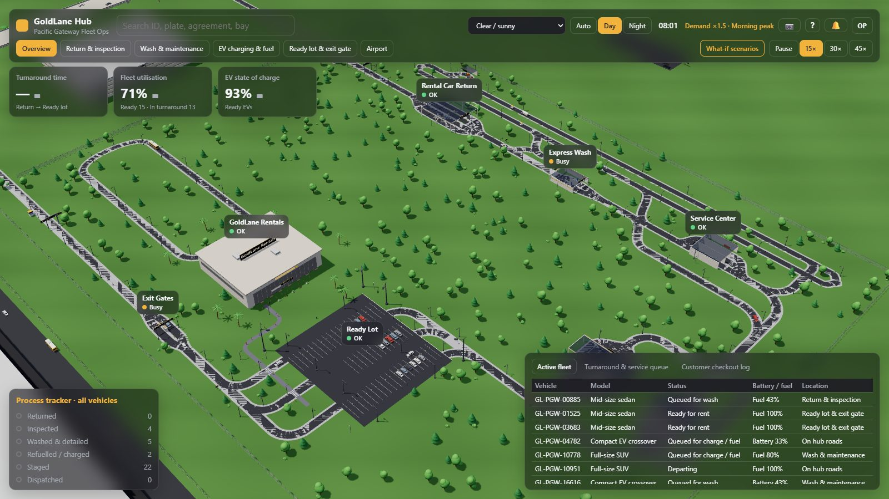
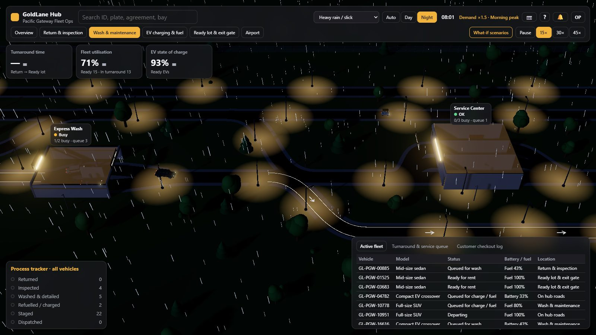
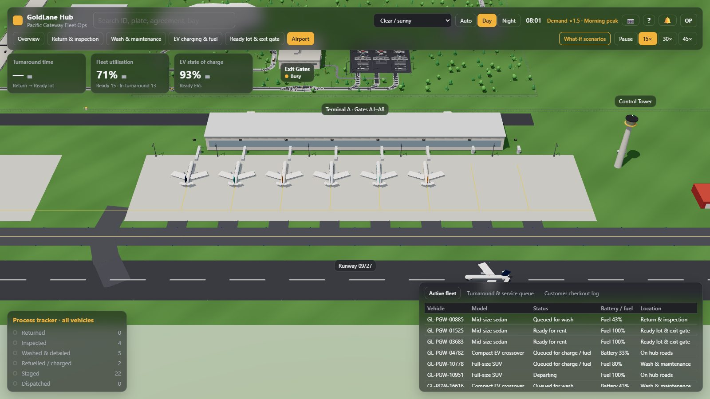
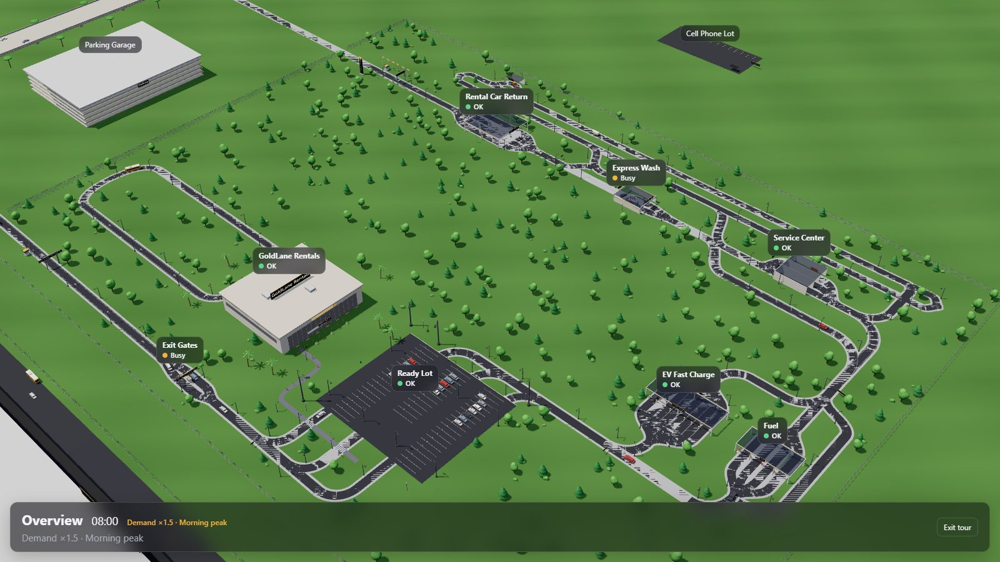

# GoldLane Hub: Pacific Gateway Fleet Ops

A living 3D operations world for a fictional airport car-rental hub, in a single offline HTML file.
Cars come back from rental, get inspected, washed, serviced, charged or fuelled, wait in the ready lot,
and leave through the exit gates, while flights land and take off at the airport next door. A glass
dashboard tracks it all live, and what-if scenarios let you close units, change crews or add a surge.



**Live:** https://subhadipgithub.github.io/World-Builder/ (once GitHub Pages is enabled; see [Publishing](#publishing)).
**Download:** the latest file is attached to each [GitHub Release](https://github.com/SubhadipGitHub/World-Builder/releases); it opens offline.



## Features

- **A simulated hub day.** A deterministic simulation (seeded, fixed time step) runs the whole turnaround with
  realistic timings at 15× real time, with morning and evening demand peaks.
- **A 3D world.** Cars, shuttles, carts and people on a lane graph that never lets them overlap; day and night,
  weather, street lights and an airport with scheduled flights.
- **A live dashboard.** KPI cards (turnaround, utilisation, EV charge), a process tracker, live tables, alerts,
  search, building labels, and light and dark themes.
- **What-if scenarios.** Presets, unit outages, crew levels and demand surges, compared live against a
  baseline hub that runs without them.
- **Share it.** Deep links, an embed mode, a kiosk tour, captioned screenshots and built-in help.



## Quick start

Requires Node.js 20 or newer.

```bash
npm ci
npm run dev        # development server at http://localhost:5173
npm run build      # one self-contained file: dist/index.html (open it straight from disk)
```

Controls: drag to pan, right-drag to rotate, wheel or pinch to zoom, click to select and follow.
Press `?` in the app for all controls and what the numbers mean, and `P` to save a screenshot.

## Testing

```bash
npm run check      # typecheck, lint and unit tests
npm run test:soak  # long simulation soaks, including a full simulated day per seed and weather (slow)
npm run test:e2e   # builds the test bundle, then runs the Playwright end-to-end suite in Chromium
npm run screenshots  # regenerates the images in docs/media
```

## Deep links

Any of these query options can be added to the page address, for example
`?area=wash&weather=rain&tod=night&preset=washDown`. Invalid values are ignored. A link never changes the
viewer's saved preferences. **Copy link** in the user menu builds one for the current view.

| Key | Values | Effect |
|---|---|---|
| `area` | `overview`, `return`, `wash`, `energy`, `lot`, `airport` | Starting area |
| `cam` | `x,z,azimuth,elevation,distance` (angles in degrees) | Exact camera position |
| `weather` | `clear`, `overcast`, `rain`, `heatwave` | Starting weather |
| `tod` | `auto`, `day`, `night` | Time of day |
| `speed` | `0` (paused), `15`, `30`, `45` | Simulation speed |
| `labels` | `0`, `1` | Building labels off or on |
| `theme` | `dark`, `light` | Interface theme |
| `quality` | `auto`, `0`, `1`, `2` | Graphics quality tier (0 is the highest) |
| `seed` | 1–32 letters, digits, `-` or `_` | Simulation seed (the same seed and preset give the same run) |
| `preset` | `fridayRush`, `washDown`, `heatCharger`, `gateClosure` | Starts a what-if preset |
| `select` | a unit or building id, e.g. `wash1`, `gate2`, `terminal` | Opens its details |
| `kiosk` | `1` | Starts the kiosk tour |
| `embed` | `1` | Embed mode |

## Embedding

Embed mode hides the dashboard and shows a compact overlay with the clock, the demand and an
"Open full view" link:

```html
<iframe
  src="https://subhadipgithub.github.io/World-Builder/?embed=1&area=overview"
  title="GoldLane Hub"
  width="960"
  height="540"
  style="border: 0"
  loading="lazy"
></iframe>
```

## Kiosk tour

Open the page with `?kiosk=1` (or choose **Start tour** in the user menu) for an unattended display: the camera
visits the six areas for 20 seconds each with a live caption. Touching the screen, the mouse or the keyboard
pauses the tour, and it resumes after 60 seconds of no input. Press Esc or **Exit tour** to leave.



## Publishing

- `.github/workflows/pages.yml` runs on every push to `main`: checks, E2E, the production build, then deploys
  `dist/index.html` to GitHub Pages. Enable it once under **Settings → Pages → Source: GitHub Actions**.
- `.github/workflows/release.yml` runs on a version tag (for example `git tag v0.8.0 && git push --tags`),
  checks the tag against `package.json`, and attaches `goldlane-hub-<version>.html` to a GitHub Release with
  the notes from [CHANGELOG.md](CHANGELOG.md).

## Tech stack and layout

TypeScript (strict), Vite with `vite-plugin-singlefile`, Three.js, Preact with signals, Vitest and Playwright.

```
src/sim/       deterministic simulation (no rendering imports, seeded, fixed time step)
src/airport/   flight schedule and airport plan (pure, like the simulation)
src/layout/    the hub's lane graph, buildings and site plan
src/render/    Three.js scene, assets, lighting, weather and camera
src/ui/        Preact dashboard and its pure helpers
src/share/     deep links, kiosk timing, captions and shortcuts
src/app/       wiring: the frame loop, input and browser adapters
docs/          requirements and architecture (the single source of truth)
tests/         unit, soak and end-to-end tests
```

The project is built spec-first: each milestone's requirements and design are agreed in `docs/` before
failing tests are written, and the code follows. See [CHANGELOG.md](CHANGELOG.md) for the milestones.

## Brands and licence

GoldLane Rentals, Pacific Gateway and every airline, company and name in this world are fictional. Any
resemblance to real companies is coincidental.

The code is released under the [MIT licence](LICENSE).
